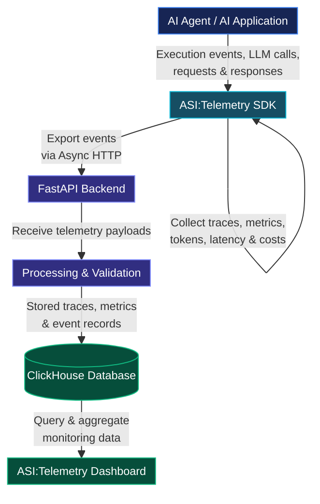

## Introduction
The idea of [ASI:Telemetry](https://asi-telemetry.vercel.app/) came to me when I was exploring and building AI agents using [uagents](https://uagents.fetch.ai/) library developed by [Fetch.ai](http://fetch.ai/).

I noticed **Fetch.ai** has [ASI:One](https://asi1.ai/) (An AI Assistant similar to ChatGPT & Claude, but here you can call your agent direclty by giving a prompt) and [Agentverse](https://agentverse.ai/) (A marketplace for AI agents where you can host your agents).

While exploring their products, I noticed one thing missing from their ecosystem: a tool for monitoring agents built with the uagent library. So, I built it: **ASI:Telemetry**, an Observability and monitoring platform for AI agents where developers can track agent performance, LLM cost, token usage, communication between multiple agents, and more, directly by installing our [SDK](https://pypi.org/project/asi-telemetry/).

```code
pip install asi:telemetry
```

## Architectural Design Of ASI:Telemetry



## How SDK Collect traces ? 
