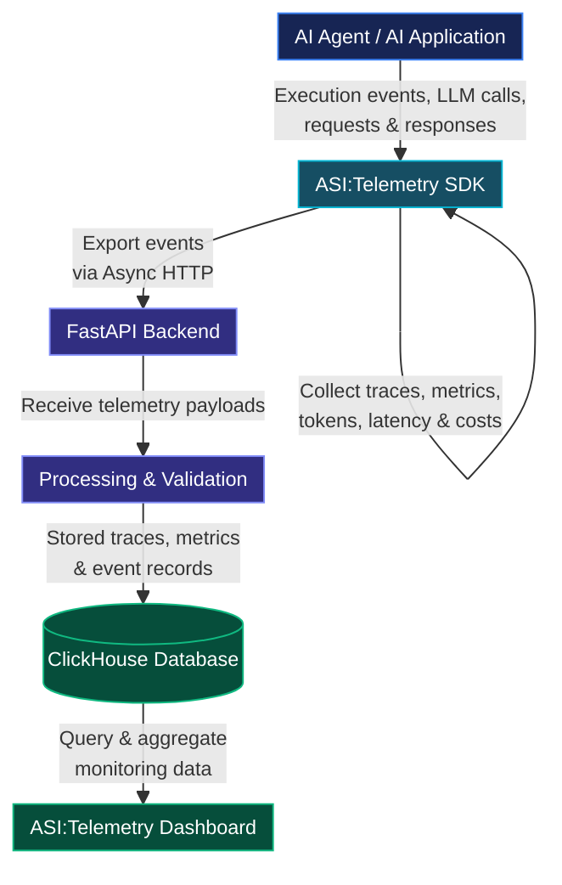
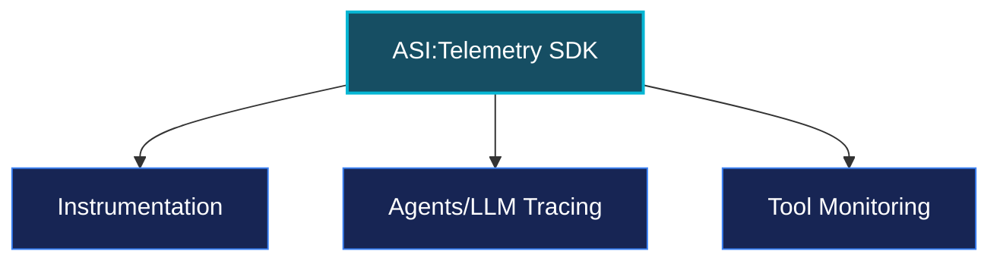

import { PackageCommand } from "@/components/package-command"


## Introduction
The idea of [ASI:Telemetry](https://asi-telemetry.vercel.app/) came to me when I was exploring and building AI agents using the [uagents](https://uagents.fetch.ai/) library developed by [Fetch.ai](http://fetch.ai/).

I noticed **Fetch.ai** has [ASI:One](https://asi1.ai/) (An AI Assistant similar to ChatGPT & Claude, but here you can call your agent directly by giving a prompt) and [Agentverse](https://agentverse.ai/) (A marketplace for AI agents where you can host your agents).

While exploring their products, I noticed one thing missing from their ecosystem: a tool for monitoring agents built with the uagent library. So, I built it: **ASI:Telemetry**, an Observability and monitoring platform for AI agents where developers can track agent performance, LLM cost, token usage, communication between multiple agents, and more, directly by installing our [SDK](https://pypi.org/project/asi-telemetry/).

<PackageCommand command="pip install asi-telemetry" />

## Architectural Design Of ASI:Telemetry



## How SDK Collect traces ? 
Now, Let's understand how **ASI:Telemetry** SDK collect traces and sends to backend, before that lets understand its main 3 core components.


Now, let's understand step by step its components and how they work.

### AI SDK Instruments
Here, what we have done is under the hood, we have created an instrumentation layer that will wrap all the AI SDK like Gemini, OpenAI, Claude etc. It helps to collect traces from the AI SDK like input token, output token, input text and more and send it to the python backend.

**For Example :**
```python
from asi_telemetry import ASI_Telemetry
from google import genai

observe = ASI_Telemetry(
    api_key="asi_live_9••••••••7cac",
    agent_name="production-assistant",
)

client = genai.Client()
observe.instrument_gemini(client)  # This will automatically monitor the AI agent and collect its traces

```
Here, we use a monkey-patching technique/method to instrument LLM API calls and collect data. As we can see in the code example above, we initialize the **observe.instrument_gemini(client)**, Under the hood it receives a reference to the Gemini client and intercept API calls, whenever LLM calls its capture relevent data and send it to python backend.

### Agent Tracing

