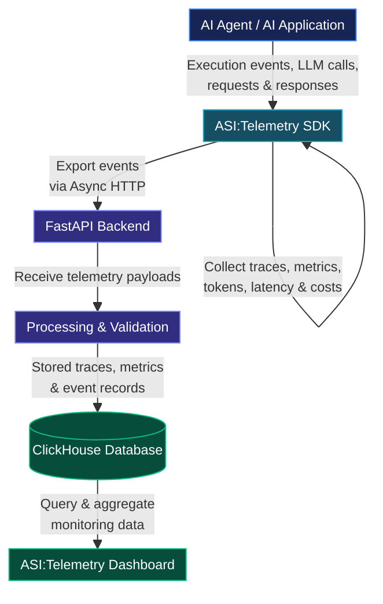
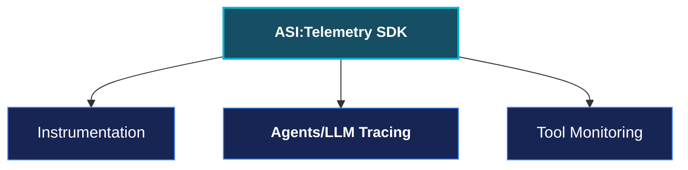
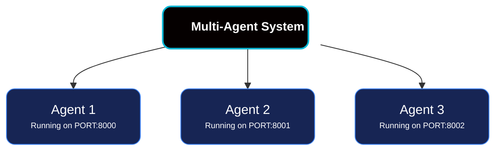

import { PackageCommand } from "@/components/package-command"


## Introduction
The idea of [ASI:Telemetry](https://asi-telemetry.vercel.app/) came to me when I was exploring and building AI agents using the [uAgents](https://uagents.fetch.ai/) library developed by [Fetch.ai](http://fetch.ai/).

I noticed **Fetch.ai** has [ASI:One](https://asi1.ai/) (An AI Assistant similar to ChatGPT & Claude, but here you can call your agent directly by giving a prompt) and [Agentverse](https://agentverse.ai/) (A marketplace for AI agents where you can host your agents).

While exploring their products, I noticed one thing missing from their ecosystem: a tool for monitoring agents built with the uAgents library. So, I built it: **ASI:Telemetry**, an Observability and monitoring platform for AI agents where developers can track agent performance, LLM cost, token usage, communication between multiple agents, and more, directly by installing our [SDK](https://pypi.org/project/asi-telemetry/).

<PackageCommand command="pip install asi-telemetry" />

## Architectural Design Of ASI:Telemetry



## How the SDK collects traces
Now, let's understand how the **ASI:Telemetry** SDK collects traces and sends them to the backend; before that, let's understand its 3 core components.


Now, let's understand step by step its components and how they work.

### AI SDK Instruments
Here, what we have done is under the hood, we have created an instrumentation layer that will wrap all the AI SDKs like Gemini, OpenAI, Claude, etc. It helps to collect traces from the AI SDK such as input tokens, output tokens, input text and more and send them to the Python backend.

**For Example :**
```python
from asi_telemetry import ASI_Telemetry
from google import genai

observe = ASI_Telemetry(
    api_key="asi_live_9••••••••7cac",
    agent_name="production-assistant",
)

client = genai.Client()
observe.instrument_gemini(client)  # This will automatically monitor the AI agent and collect its traces

```
Here, we use a monkey-patching technique to instrument LLM API calls and collect telemetry data. As seen in the code example above, when we initialize **observe.instrument_gemini(client)**, it receives a reference to the Gemini client and intercepts API calls. Whenever the LLM is called, it captures relevant data and sends it to the Python backend.


### Agents/LLM Tracing
Here, tracing works for both single-agent and multi-agent systems. As we know, in multi-agent systems, an LLM may make multiple tool calls and function calls to complete a single task or multiple tasks. Manually tracing each individual tool call can be frustrating and time-consuming.

To solve this problem, we automate the entire tracing process through the integration of the **ASI:Telemetry** SDK.

Let's take an example to understand this more clearly.



**Example:**

Let's suppose Agent1 is the starting point of a multi-agent communication workflow. Agent1 contains multiple tools (e.g., database calls, API calls, etc.) to complete its assigned task. Once completed, it passes the result to Agent2, which processes the result to complete its own task. Finally, the result is passed to Agent3 to complete the final task.

In this scenario, multiple agents collaborate to accomplish a single task.

The **ASI:Telemetry SDK** helps to automatically collect all the traces from all agents and send them to the backend. It correlates all these traces and represents the entire workflow as a **single multi-agent communication trace**, while also maintaining **individual traces for each agent and its tool/function calls**.

This is how we provides both a high-level view of the complete multi-agent workflow and detailed visibility into individual operations.


