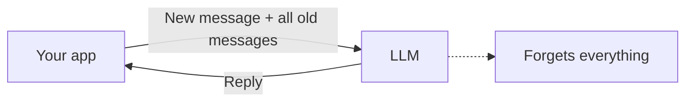
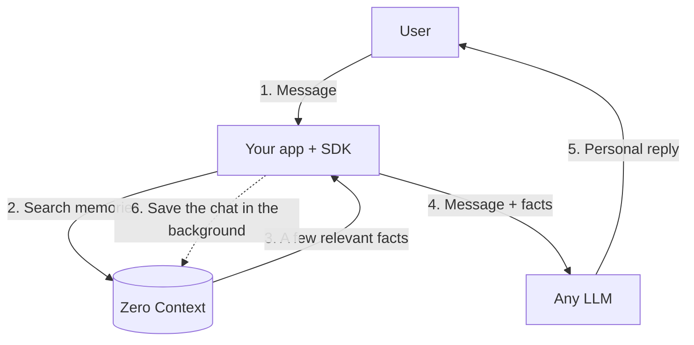
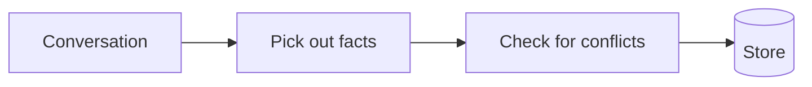

## Why I built this

If you build AI apps, you hit the same wall sooner or later. The agent works great in one chat. Then the chat ends, and it has forgotten everything about the user.

Every new session starts from zero. The user has to say again what they are working on, what stack they use, how they like things done. It feels like talking to someone with no memory.

I wanted to fix this once, properly, so I built **Zero Context**. It is a memory service you plug into any AI app with a small SDK. Your agent remembers the user, and you don't have to build the memory system yourself.

---

## Why LLMs can't remember anything

This part confused me when I started, so let me explain it simply.

An LLM is just a function. You give it text, it gives you text back. That's it.

- What it knows is stored in its weights, and those are fixed after training. Talking to it doesn't change them.
- It keeps nothing between two calls. Every request is a fresh start.
- It only sees what is inside the current prompt, and that space (the context window) has a limit.

So how does ChatGPT remember what you said two messages ago? It doesn't. The app sends the whole conversation again with every new message.



This works for a short chat. In a real product it causes problems:

1. It costs more, because you pay for every token on every call.
2. It is slower, because bigger prompts take longer to process.
3. Answers get worse, because models lose track of details in very long prompts.
4. Agents can't share what they know. Your support agent has no idea what your billing agent just talked about.

So the real fix is not "send more history". It is "send only the few things that matter". For that, memory has to live outside the model.

---

## The old way is slow

Building that memory layer yourself sounds easy until you start. You need to:

1. Pick a vector database and run it
2. Pick an embedding model and decide how to split text
3. Write prompts that pull useful facts out of conversations
4. Deal with duplicates and facts that are no longer true
5. Keep every user's data separate from everyone else's
6. Support deleting a user's data when they ask

That is weeks of work before you ship anything your users can actually see. Then you have to maintain it. And on your next project, you do it all again.

I didn't want to keep doing that. We already use PostgreSQL instead of writing our own storage engine, so memory should work the same way: something you just call. That is the idea behind Zero Context.

---

## How it works

Keep memory outside the model. When the user sends a message, look up the few facts that matter and add them to the prompt.



### Reading

When the user asks something, the SDK searches Zero Context. It gets back the top few facts, like "uses AWS" or "prefers Docker". You put them in the prompt and call your model.

Reading is just one search. There is no LLM call in this step, so it stays fast and the user doesn't notice it.

### Writing

After the reply, the chat is saved in the background. This part needs more work, so we keep it away from the user's request:



A few things happen here:

- **Picking facts.** Not everything is worth saving. If someone says "nice weather today, and I prefer Python over JavaScript", we keep only "prefers Python".
- **Updating facts.** If a user says "I live in New York" and months later says "I moved to London", the old fact gets replaced. We don't keep both.
- **Searching by meaning.** If the user asks "which language should we use?", we can still find the Python fact, even though the word "language" was never saved. This is done with embeddings, usually mixed with normal keyword search.
- **Keeping data separate.** Each user and each customer has their own space. Memories never mix.

---

## What the code looks like

```python
from zero_context import ZeroContextClient

memory = ZeroContextClient(api_key="your_api_key")
user_id = "user_123"
user_message = "Help me configure our database backup script."

# 1. Get only the memories that matter for this message
facts = memory.memories.search(query=user_message, user_id=user_id, limit=3)
notes = "\n".join(f"- {m.text}" for m in facts)

# 2. Put them in your prompt and call any LLM
prompt = f"""You are a helpful DevOps assistant.
What we know about this user:
{notes}

Request: {user_message}"""
reply = call_llm(prompt)

# 3. Save the chat (the heavy work happens in the background on our side)
memory.memories.add(
    messages=[
        {"role": "user", "content": user_message},
        {"role": "assistant", "content": reply},
    ],
    user_id=user_id,
)
```

That's all. No vector database to set up and no embedding workers to run.

Here is how you can use it in a real application with the OpenAI Python SDK:

```python
import os
from openai import OpenAI
from zero_context import ZeroContextClient

# Initialize clients
ai = OpenAI(api_key=os.environ.get("OPENAI_API_KEY"))
memory = ZeroContextClient(api_key=os.environ.get("ZERO_CONTEXT_API_KEY"))

user_id = "user_123"
user_message = "What was the database port and backup path we set earlier?"

# 1. Look up only relevant facts from past conversations
memories = memory.memories.search(query=user_message, user_id=user_id, limit=3)
context = "\n".join(f"- {m.text}" for m in memories) if memories else "No prior context."

# 2. Pass those facts into OpenAI as system context
response = ai.chat.completions.create(
    model="gpt-4o-mini",
    messages=[
        {
            "role": "system",
            "content": f"You are a helpful assistant.\nRemembered user facts:\n{context}",
        },
        {"role": "user", "content": user_message},
    ],
)
reply = response.choices[0].message.content

# 3. Save the conversation in background so the agent remembers next time
memory.memories.add(
    messages=[
        {"role": "user", "content": user_message},
        {"role": "assistant", "content": reply},
    ],
    user_id=user_id,
)

print(reply)
```

---

## Where it fits

| What | Does it remember you? | Who uses it |
| :--- | :--- | :--- |
| Raw LLM APIs (GPT, Claude, Gemini) | No, every call starts fresh | Developers |
| Chat apps (ChatGPT, Claude.ai) | Yes, but only inside their own app | Everyday users |
| Zero Context | Yes, across any app, model or agent you build | Developers building AI products |

---

## The hard parts

Memory looks simple from outside. These are the parts that are not:

- **Relevance.** If you pull in 50 memories, the prompt gets messy. You want the best few, not everything.
- **Changing facts.** People move cities, change jobs and switch tech stacks. Old facts have to go away correctly.
- **Speed.** Memory lookup should never become the slow part of your app.
- **Privacy.** If a user wants their data deleted, it has to be removed from every place it is stored, including the vector index.

---

## Final thoughts

LLMs are good at reasoning, writing and coding. But without memory, every conversation starts from nothing, and that limits what agents can do.

Apps use databases so they don't have to build storage again and again. AI agents need the same thing for memory. That is what I'm trying to give with Zero Context: two function calls, and your agent remembers.